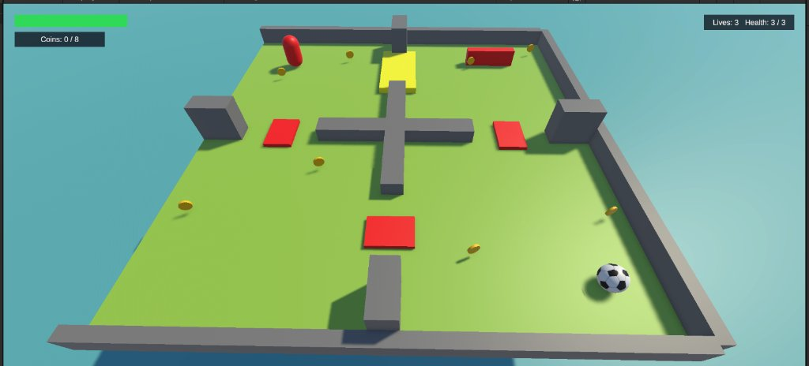
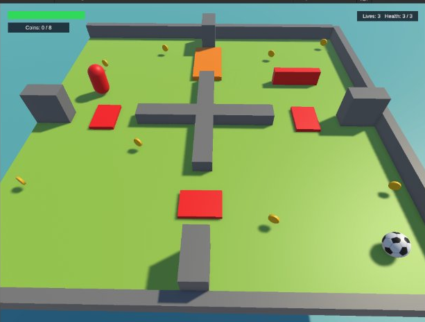
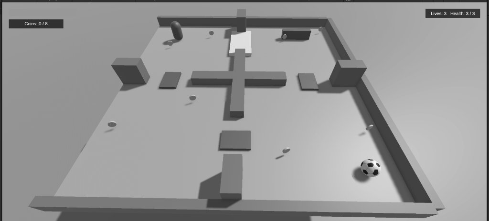

# CS464 Assignment 04 · Omer Abdullah · BSCS25135

**Video (90–180 s):** https://drive.google.com/file/d/1PUWK1aFRMcdrD8i2nAaNVBDwo5YdgmwR/view?usp=sharing

## Settings

| Part | Setting | Value | Why |
|---|---|---|---|
| A | Harmony · base hue | triadic · 220° | Separates container panels (indigo), UI text/highlights (amber), and health fill (emerald) for chromatic clarity. |
| A | Dark · mid · light | #141928 · #283859 · #FAFAFA | Establishes a three-tier luminance ramp so backgrounds, interactive buttons, and text remain distinct in grayscale. |
| A | Accents | #F2BF33 · #33D959 · #D96633 | Provides high-contrast visual cues for victory titles/coins (gold), health status (green), and damage lag (orange). |
| A | HUD text on dark panel | 16.67 : 1 | Exceeds WCAG AAA standard (7:1) ensuring score, lives, and labels are readable during fast ball movement. |
| A | Button label on mid button | 11.13 : 1 | Exceeds WCAG AAA to keep menu button actions (Resume, Restart, Quit) unmistakable on all displays. |
| B | Music · SFX groups, as mixed | -6.0 dB · 0.0 dB | Attenuates continuous soundtrack so transient gameplay sound effects (hits, pickups) remain prominent. |
| B | Slider at 1 · 0.5 · 0.0001 | 0 dB · -6 dB · -80 dB | Logarithmic mapping (20*log10(v)) matches human non-linear loudness perception down to silent. |
| C | WorldHumSound, in Level 1 | Logarithmic · Min 2 m · Max 25 m | Gives realistic 3D acoustic warning when rolling close to the moving hazard, fading over distance. |
| C | WorldHumSound, in Level 2 | Logarithmic · Min 2 m · Max 25 m | Provides directional audio cue pointing player toward the hazard zone in the second arena. |
| C | AudioListener | on the camera | Top-down camera maintains fixed perspective over arena, providing consistent panning across stereo field. |
| D | unlocked | int · default 1 | Allows new players to immediately play Level 1 while keeping subsequent levels gated until completed. |
| D | best1 ... best5 | float · HasKey first | Checks HasKey before reading so unplayed levels display no record instead of a misleading 0.0 s. |
| D | MusicVolume | float · default 1 | Retains player volume preference in registry across scenes and game launches. |

## Answers

1. Effects of Time.timeScale = 0

Time.timeScale = 0 essentially halts game functionality which is based around time, for example physics, objects’ movement (using Time.deltaTime), forces on rigidbodies and time-based animation. The function FixedUpdate is also halted. However, Update and LateUpdate cannot be halted and so still execute each frame. Objects which utilise Time.unscaledDeltaTime and Time.realtimeSinceStartup continue to function as normal. As a result, user interface, pause menu and lag bar functionality can still operate. Likewise, coroutines can still execute using yield return null and WaitForSecondsRealtime.

2. What remains in a LoadScene

GameObject’s from a previously loaded scene are deleted when another scene is loaded via SceneManager.LoadSceneAsync – unless they have been designated to persist. Within our game, the AudioSystem is able to do this as the DontDestroyOnLoad(gameObject) function is executed in Awake in both PersistentMusic and SfxPlayer. As static variables including SaveData properties and PauseMenu.IsPaused exist within memory, they are not scene specific and so they too persist. Furthermore, information such as levels which have been unlocked, music volume and best times are saved through PlayerPrefs.Save(), meaning these will continue to be saved even if the game is exited.

3. Purpose of default values for PlayerPrefs

When a player initially installs our game, or deletes their saved data, the keys we attempt to access from PlayerPrefs may not yet be present. We therefore assign default values to these keys e.g. 1 for unlocked and 1f for MusicVolume. This ensures that our game does not incorrectly prevent the player from accessing Level 1 or turn off the music. Prior to displaying best times, our game uses SaveData.HasBest(level) to verify that a best time does in fact exist. Therefore, we do not display 0.0 seconds as a level completion time for a level which has not yet been completed by the player.

4. Consequences of not unsubscribing from events and why we do

If an object adds itself to an event via += but does not then remove itself from the event via -=, a reference to the object will still be retained by the event even if the object is destroyed or disabled. Should this event then fire again, it may attempt to invoke a method on an object which no longer exists and thereby create either a MissingReferenceException or NullReferenceException. Memory leaks can also occur. Within our game, HealthBar, HitSound, HitSparks and GameOver all unsubscribe from events in OnDisable, corresponding to those events to which they had added themselves in OnEnable. Hence, this problem does not occur.

## Credits

- pickup.wav, hit.wav, click.wav, win.wav, lose.wav, music_loop.wav, hum_loop.wav · BSCS25135 · Assets/Audio/CREDITS_SOURCES.txt · CC0 / Public Domain
